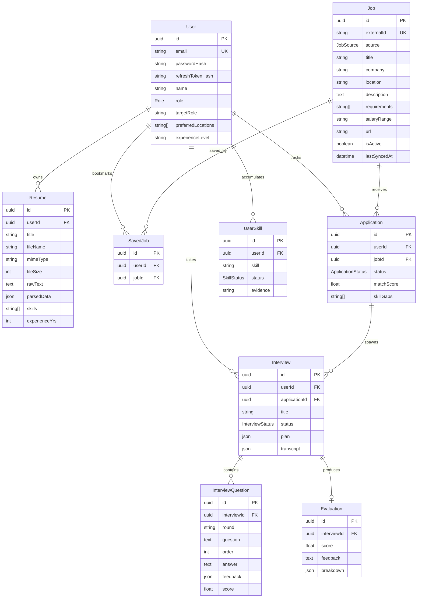

# API Reference & Data Model

## Database Schema Overview

TrueHire uses PostgreSQL 15 managed via Prisma (`server/prisma/schema.prisma`). The schema defines **14 models** across two functional domains:

- **Core Candidate & Career Pipeline (9 models):** `User`, `Resume`, `Job`, `SavedJob`, `Application`, `Interview`, `InterviewQuestion`, `Evaluation`, `UserSkill`.
- **Ontology & Operations Telemetry (5 models):** `OntologyAlias`, `AiRequestAudit`, `JobSyncAudit`, `ResumeParseAudit`, `FeatureUsageEvent`.

### Entity-Relationship Diagram



### Standalone Observability & Ontology Tables

| Model (`@@map`) | Key Columns | Purpose |
| --- | --- | --- |
| `OntologyAlias` (`ontology_aliases`) | `rawSkill`, `canonicalSkill`, `status` (`APPROVED`/`REJECTED`/`PENDING`), `createdBy` | Persists admin-approved skill aliases and dismissed tokens loaded at server boot. |
| `AiRequestAudit` (`ai_request_audits`) | `userId`, `feature`, `provider`, `model`, `status`, `latencyMs`, `inputTokens`, `outputTokens`, `costUsd`, `errorCode` | Durable telemetry log for every AI call across providers and fallbacks. |
| `JobSyncAudit` (`job_sync_audits`) | `source`, `boardToken`, `status`, `jobsFetched`, `jobsCreated`, `jobsUpdated`, `jobsDeactivated`, `duplicatesFound`, `durationMs` | Tracks ATS ingestion health and cross-board deduplication metrics. |
| `ResumeParseAudit` (`resume_parse_audits`) | `userId`, `resumeId`, `mimeType`, `status`, `qualityScore`, `textLength`, `warnings`, `durationMs` | Tracks PDF/DOCX/paste extraction quality and parse failures. |
| `FeatureUsageEvent` (`feature_usage_events`) | `userId`, `event`, `metadata` | Tracks closed-loop product milestones (`interview_created`, `evaluation_generated`, etc.). |

---

## REST API Reference

Base URL: `/api` (e.g. `http://localhost:5000/api`).

**Authentication:** Protected endpoints require `Authorization: Bearer <accessToken>`. Refresh tokens (`tokenType: "refresh"`) are rejected on normal endpoints and accepted only by `POST /api/auth/refresh`.

**Error Format:** Errors return a consistent JSON shape from the centralized error handler (`server/src/app.ts`):

```json
{
  "success": false,
  "code": "ERROR_CODE",
  "message": "Human-readable explanation",
  "error": "Human-readable explanation"
}
```

### Health (`server/src/app.ts`)

| Method | Path | Auth | Description & Response |
| --- | --- | --- | --- |
| `GET` | `/api/health` | Public | Runs `SELECT 1` on PostgreSQL and returns `{ success, status: "ok" \| "degraded", database, aiConfigured, aiReliability }`. |

### Authentication (`server/src/routes/auth.ts`)

| Method | Path | Auth | Request Body | Response |
| --- | --- | --- | --- | --- |
| `POST` | `/api/auth/register` | Public (rate-limited) | `{ email, password, name }` | `201 { user, token, refreshToken }` |
| `POST` | `/api/auth/login` | Public (rate-limited) | `{ email, password }` | `200 { user, token, refreshToken }` |
| `POST` | `/api/auth/refresh` | Public (rate-limited) | `{ refreshToken }` | `200 { user, token, refreshToken }` (rotates stored hash; rejects revoked/null hashes) |
| `POST` | `/api/auth/logout` | Bearer (`USER`/`ADMIN`) | — | `200 { message }` (clears server-side `refreshTokenHash`) |
| `GET` | `/api/auth/me` | Bearer | — | `200 User` |
| `PUT` | `/api/auth/profile` | Bearer | `{ name?, email?, password?, targetRole?, preferredLocations?, experienceLevel? }` | `200 User` (revokes refresh token if password changes) |

### Resumes & Tailoring (`server/src/routes/resumeRoutes.ts`)

| Method | Path | Auth | Request Body | Response |
| --- | --- | --- | --- | --- |
| `POST` | `/api/resumes` | Bearer (upload-limited) | `multipart/form-data` (`file`: PDF/DOCX <= 5 MB, optional `title`) | `201 Resume` with extracted `skills`, `parsedData`, `experienceYrs` |
| `POST` | `/api/resumes/paste` | Bearer (upload-limited) | `{ title?, rawText }` | `201 Resume` |
| `GET` | `/api/resumes` | Bearer | — | `200 Resume[]` (current user's resumes) |
| `GET` | `/api/resumes/:id` | Bearer | — | `200 Resume` |
| `POST` | `/api/resumes/:id/reanalyze` | Bearer (upload-limited) | — | `200 Resume` (re-runs AI + deterministic skill extraction) |
| `PATCH` | `/api/resumes/:id/sections` | Bearer | `{ parsedData?, skills?, title? }` | `200 Resume` |
| `DELETE` | `/api/resumes/:id` | Bearer | — | `200 { message }` |
| `POST` | `/api/resumes/:id/tailoring` | Bearer | `{ jobId }` | `200` evidence-bounded tailoring plan & bullet diffs |
| `POST` | `/api/resumes/:id/tailoring/apply` | Bearer | `{ jobId, acceptedBulletIds, ... }` | `200` updated resume with accepted evidence-bounded edits |

### Jobs & Saved Roles (`server/src/routes/jobRoutes.ts`)

| Method | Path | Auth | Request Body / Query | Response |
| --- | --- | --- | --- | --- |
| `GET` | `/api/jobs` | Bearer | Optional query filters (`search`, `location`, `source`) | `200 { jobs, syncHealth }` |
| `GET` | `/api/jobs/saved` | Bearer | — | `200 Job[]` |
| `GET` | `/api/jobs/:id` | Bearer | — | `200 Job` (or `404 JOB_NOT_FOUND`) |
| `POST` | `/api/jobs/external` | Bearer | `{ title, company, description, location?, source?, url?, salaryRange? }` (`url` validated `http:`/`https:` only) | `201 Job` with extracted `requirements[]` |
| `POST` | `/api/jobs/:id/save` | Bearer | — | `201 SavedJob` |
| `DELETE` | `/api/jobs/:id/save` | Bearer | — | `200 { message }` |
| `POST` | `/api/jobs/sync` | Bearer + `ADMIN` | `{ boardToken?, company? }` | `200` sync summary (`totalSaved`, `totalDeactivated`, etc.) |
| `POST` | `/api/jobs/sync/greenhouse` | Bearer + `ADMIN` | `{ boardToken?, company? }` | `200` Greenhouse board sync summary |

### Matching & Role-Fit Radar (`matchRoutes.ts`, `radarRoutes.ts`)

| Method | Path | Auth | Request Body / Query | Response |
| --- | --- | --- | --- | --- |
| `POST` | `/api/matches` | Bearer | `{ resumeId, jobId }` | `200` match score, matched/missing skills, evidence breakdown, `INSUFFICIENT_DATA` flag when posting lacks skills |
| `POST` | `/api/matches/simulate` | Bearer | `{ resumeId, jobId, addedSkills: string[] }` | `200` simulated score delta & unlocked requirements |
| `GET` | `/api/radar` | Bearer | `?resumeId=<uuid>` (optional) | `200 { success, data }` ranked role-fit clusters and top skill multipliers |

### Applications Tracker (`server/src/routes/applicationRoutes.ts`)

| Method | Path | Auth | Request Body | Response |
| --- | --- | --- | --- | --- |
| `GET` | `/api/applications` | Bearer | — | `200 Application[]` (with nested `job` & `interviews`) |
| `GET` | `/api/applications/:id` | Bearer | — | `200 Application` |
| `POST` | `/api/applications/job/:jobId` | Bearer | — | `201 Application` (idempotent per `(userId, jobId)`) |
| `PATCH` | `/api/applications/:id/status` | Bearer | `{ status: "SAVED" \| "APPLIED" \| "INTERVIEWING" \| "OFFER" \| "REJECTED" }` | `200 Application` |
| `DELETE` | `/api/applications/:id` | Bearer | — | `200 { message }` |

### Adaptive Mock Interviews (`server/src/routes/interviewRoutes.ts`)


| Method | Path | Auth | Request Body | Response |
| --- | --- | --- | --- | --- |
| `GET` | `/api/interviews` | Bearer | — | `200 Interview[]` |
| `POST` | `/api/interviews` | Bearer (AI-limited) | `{ applicationId, customConfig?: { durationMinutes, difficulty, focusTopics, selectedRounds } }` | `201 Interview` with plan & ordered `questions[]` |
| `GET` | `/api/interviews/:interviewId` | Bearer | — | `200 Interview` (with `questions[]`, `evaluation`, `transcript`) |
| `POST` | `/api/interviews/:interviewId/start` | Bearer | — | `200 { interview, firstQuestion }` (transitions `SCHEDULED` -> `IN_PROGRESS`) |
| `POST` | `/api/interviews/:interviewId/questions/:questionId/answer` | Bearer (AI-limited) | `{ answer: string }` | `200 { evaluation, completed, nextQuestion, adaptiveFollowUp? }` (returns `409 ALREADY_ANSWERED` if already scored, `503 EVALUATION_PENDING` if AI fails after saving raw answer) |
| `POST` | `/api/interviews/:interviewId/evaluation` | Bearer (AI-limited) | — | `200 Evaluation` (persists 6-dimension breakdown, `UserSkill` evidence, and structured transcript) |

### Readiness & Skill Ontology (`readinessRoutes.ts`, `ontologyRoutes.ts`)

| Method | Path | Auth | Request Body | Response |
| --- | --- | --- | --- | --- |
| `GET` | `/api/readiness` | Bearer | — | `200` aggregated readiness score, skill ledger (`VERIFIED`, `WEAK`, `RESUME_EXTRACTED`, `MISSING`), interview evidence history |
| `POST` | `/api/readiness/proof` | Bearer | `{ skill, proofText, repositoryUrl?, ... }` | `200` verified skill update recorded to `user_skills` |
| `GET` | `/api/ontology/dashboard` | Bearer | — | `200 { success, data }` ontology coverage, family stats, false-positive audit, benchmark, review queue (non-admin resume scan scoped strictly to current user) |
| `POST` | `/api/ontology/review-queue/resolve` | Bearer + `ADMIN` | `{ token, action: "APPROVE_CANONICAL" \| "MAP_ALIAS" \| "DISMISS", canonicalTarget? }` | `200 { success, data }` persisted to `ontology_aliases` |

### Admin Operations Control Plane (`server/src/routes/adminRoutes.ts`)

All `/api/admin/*` endpoints require `authMiddleware`, `requireRole("ADMIN")`, and `adminLimiter`.

| Method | Path | Description |
| --- | --- | --- |
| `GET` | `/api/admin/overview` | Aggregate system health across users, jobs, resumes, AI, and interviews (`?rangeDays=1\|7\|30\|ALL`). |
| `GET` | `/api/admin/job-syncs` | Recent `JobSyncAudit` history, failure counts, and board status. |
| `GET` | `/api/admin/ai-reliability` | Provider latency, fallback rate, token usage, and estimated USD cost from `AiRequestAudit`. |
| `GET` | `/api/admin/resume-quality` | Parse success rates, low-quality parse warnings, and duration stats from `ResumeParseAudit`. |
| `GET` | `/api/admin/matching-quality` | Ontology coverage, `INSUFFICIENT_DATA` job ratio, and pending review queue items. |
| `GET` | `/api/admin/closed-loop` | Interview completion rates, skill write-backs, and retention telemetry from `FeatureUsageEvent`. |
| `POST` | `/api/admin/job-syncs/run` | Manually triggers a multi-board ATS job sync. |
| `POST` | `/api/admin/ontology/review-queue/resolve` | Resolves pending ontology tokens directly from the Admin Console. |
