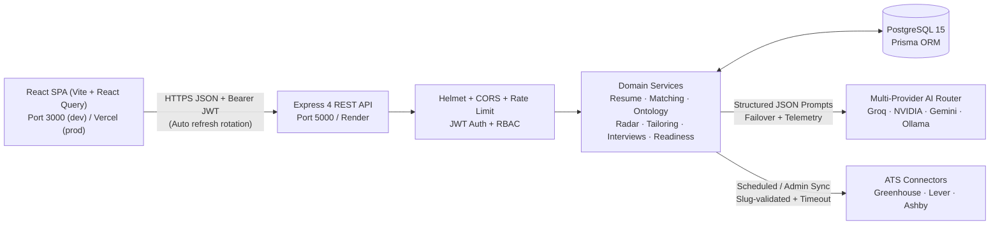
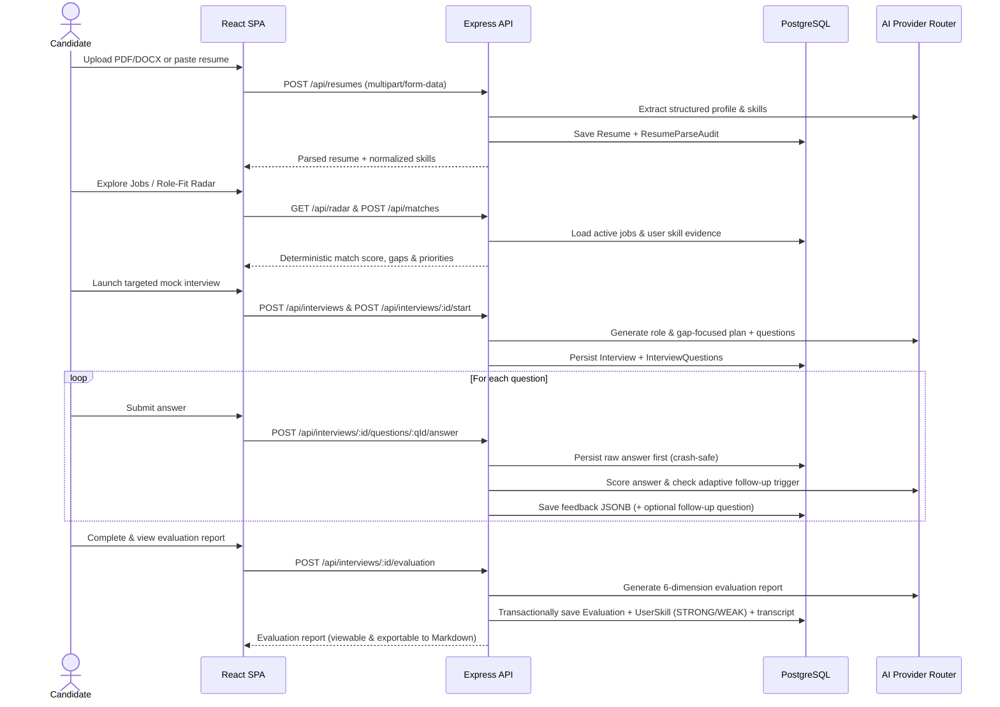

# System Architecture

## Overview

**TrueHire** (repository root `career-lens-monorepo`) is a full-stack TypeScript career readiness and technical interview preparation platform built around a closed-loop workflow: candidates upload or paste a resume, discover verified software engineering postings synced from public ATS boards, inspect deterministic skill-gap coverage and role-fit rankings, tailor resume bullets with evidence bounds, run adaptive AI mock interviews, and persist verified or weak skill evidence back into their readiness profile.


## Tech Stack

| Layer | Technologies |
| --- | --- |
| **Frontend (`client/`)** | React 18, TypeScript 5, Vite 5, Tailwind CSS 3, React Router 6, TanStack React Query 5, React Hook Form + Zod, Lucide React, Framer Motion |
| **Backend (`server/`)** | Node.js 20, Express 4, TypeScript 5, Prisma ORM 5, Zod, Helmet, CORS, Express Rate Limit, Multer, `pdf-parse`, `mammoth`, `bcryptjs`, `jsonwebtoken` |
| **Database** | PostgreSQL 15 (managed via Prisma schema & forward SQL migrations) |
| **AI Provider Router** | OpenAI-compatible SDK (`openai` v7) routing across Groq, NVIDIA NIM, Google Gemini, or local Ollama with automatic failover and JSON repair |
| **Job Ingestion** | Greenhouse public board API + Lever/Ashby connectors + external manual job import |
| **Observability & Testing** | Vitest (unit & integration), Supertest, Playwright (E2E), optional Sentry (`@sentry/react` / `@sentry/node` hooks via `SENTRY_DSN` / `VITE_SENTRY_DSN`), built-in Admin Operations Console |

## Folder Structure

```text
.
├── client/                     # React + Vite SPA
│   ├── src/
│   │   ├── components/         # Shared UI primitives, ErrorBoundary, AppShell, Sidebar, TopNav, CommandPalette
│   │   ├── features/           # Domain-sliced modules:
│   │   │   ├── admin/          #   Admin Operations Console (/admin)
│   │   │   ├── auth/           #   AuthContext, ProtectedRoute, Login/Register, Onboarding, Profile
│   │   │   ├── dashboard/      #   Candidate Readiness Overview (/dashboard)
│   │   │   ├── interview/      #   Prep, Live Interview, Evaluation + Markdown export (/interviews/*)
│   │   │   ├── jobs/           #   Verified Jobs Explorer & Saved Jobs (/jobs, /saved-jobs)
│   │   │   ├── landing/        #   Public marketing & workflow preview (/)
│   │   │   ├── matching/       #   Match breakdown & Skill Gap simulator (/matches/:jobId, /skill-gaps/:jobId)
│   │   │   ├── ontology/       #   Skill Ontology diagnostics & admin alias review (/ontology)
│   │   │   ├── radar/          #   Role-Fit Radar rankings (/radar)
│   │   │   ├── readiness/      #   Skill Readiness Ledger & proof submission (/readiness)
│   │   │   ├── resume/         #   Resume upload/paste, parsing & section editor (/resume)
│   │   │   ├── tailoring/      #   Evidence-bounded resume tailoring (/tailor/:jobId)
│   │   │   └── tracker/        #   Application pipeline Kanban/list tracker (/applications)
│   │   ├── lib/                # apiClient (token rotation), sanitize (HTML/URL allowlist), Sentry init
│   │   ├── services/           # Auth API helpers
│   │   └── __tests__/          # Client unit tests (Vitest)
│   └── tests/e2e/              # End-to-end Playwright specs & fixtures
├── server/                     # Express + Prisma REST API
│   ├── prisma/
│   │   ├── migrations/         # PostgreSQL SQL migrations (including schema/observability sync)
│   │   ├── schema.prisma       # Authoritative relational data model (14 models)
│   │   └── seed.ts             # Local development seed script
│   └── src/
│       ├── config/             # Zod env validation + fail-closed prod checks, Prisma client, Sentry
│       ├── controllers/        # HTTP request/response handlers
│       ├── integrations/       # Multi-provider AI client + telemetry; Greenhouse/Lever/Ashby clients
│       ├── middleware/         # JWT auth, RBAC requireRole, rate limiters, Multer upload validation
│       ├── modules/            # Interview prompts, Zod output schemas, adaptive evaluator
│       ├── repositories/       # Prisma persistence queries & transactional writes
│       ├── routes/             # Canonical /api/* Express routers (10 domain modules)
│       ├── services/           # Business logic (auth, resume, matching, ontology, radar, readiness, interviews, admin)
│       ├── utils/              # AppError, JWT access/refresh signing, resilient LLM JSON parser
│       └── __tests__/          # Backend Vitest suites (15 test files)
├── docs/                       # Production documentation and UI screenshots
├── .github/workflows/          # CI, CD, and Playwright E2E pipelines
├── docker-compose.yml          # Local PostgreSQL 15 service
└── render.yaml                 # Render backend deployment blueprint
```

## System Architecture Diagram



## Core Closed-Loop User Flow




## Key Design Patterns

- **Closed-Loop Skill Evidence:** Resume claims start as unverified (`RESUME_EXTRACTED`); interview evaluations and proof submissions transactionally write `STRONG` or `WEAK` rows into `user_skills`, which directly influence readiness scores, match confidence, and Role-Fit Radar recommendations.
- **Deterministic Skill Ontology (`server/src/services/matching/skillDictionary.ts`):** Canonical skills, aliases, families, and prerequisites are resolved deterministically before matching or gap calculation. Unrecognized tokens are queued for admin review and persisted in `ontology_aliases`.
- **Fail-Safe Interview Answer Persistence:** `submitAnswerService` writes the candidate's raw answer before invoking AI scoring. If AI evaluation fails (`503 EVALUATION_PENDING`), the answer is preserved and retryable; once scored, the question is locked (`409 ALREADY_ANSWERED`).
- **Defense-in-Depth Rendering & Auth:** Untrusted job posting HTML passes through an allowlist sanitizer (`client/src/lib/sanitize.ts`) and external links require `http:`/`https:`. Access and refresh JWTs carry distinct `tokenType` claims, refresh tokens are stored hashed with constant-time comparison and rotated/revoked on logout, and React routes are wrapped in a global `ErrorBoundary` with `React.lazy` code splitting.
